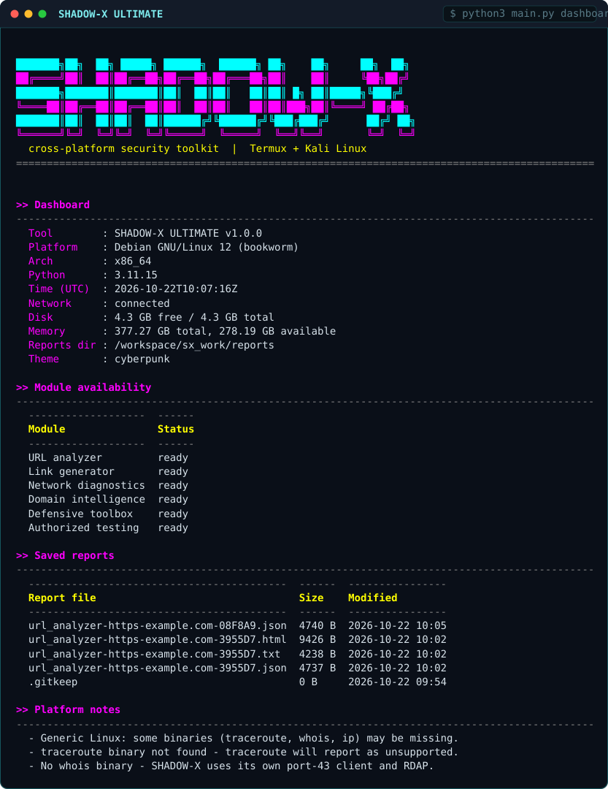
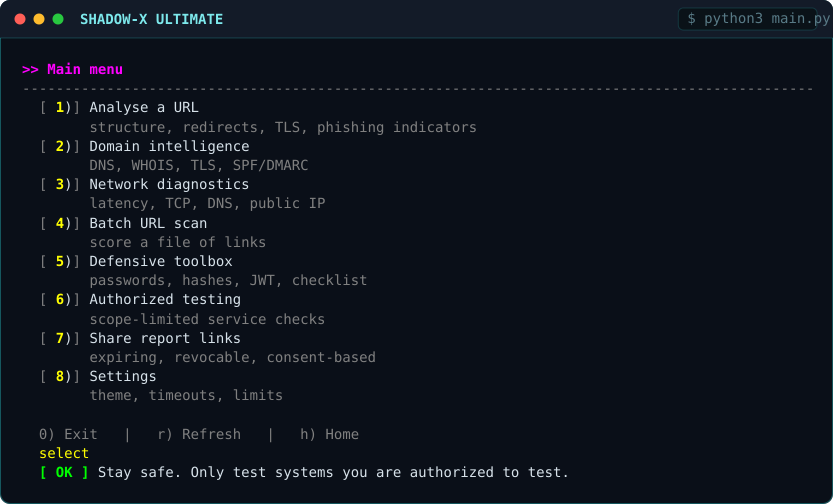
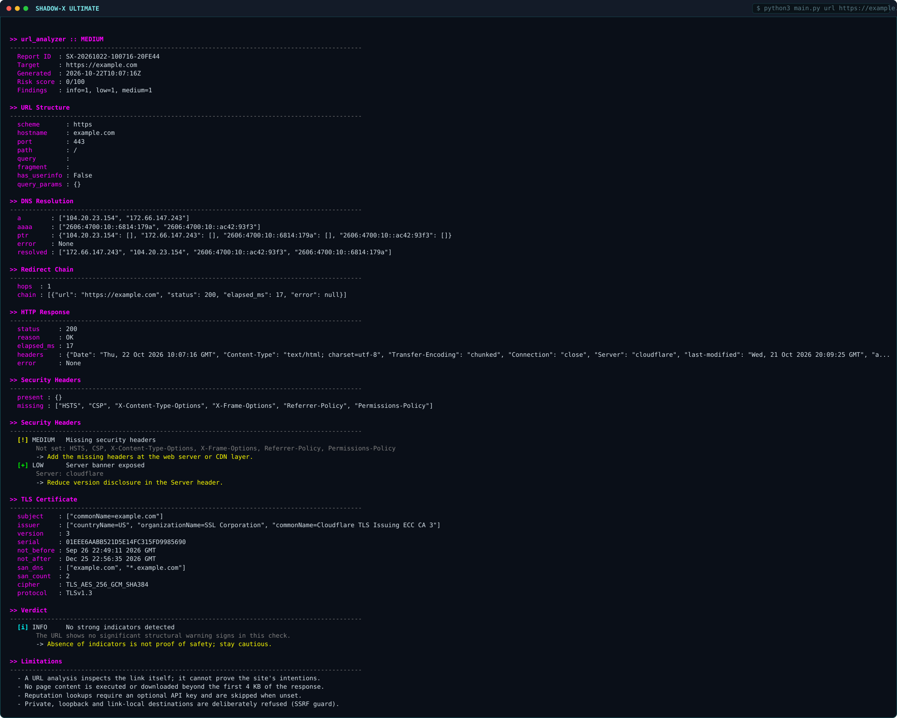
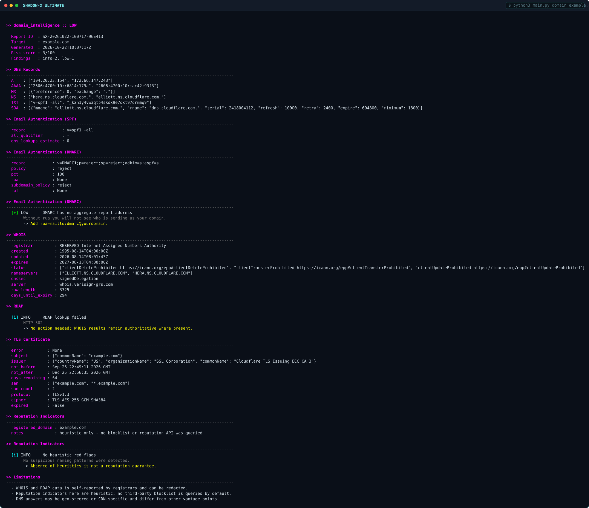
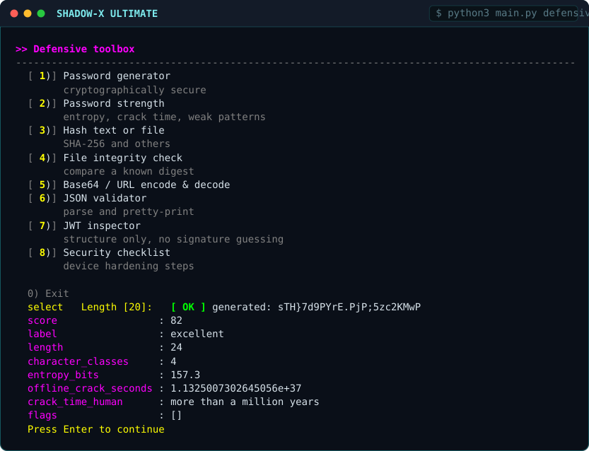

# SHADOW-X ULTIMATE

**Cross-platform cybersecurity toolkit for Termux (Android) and Kali Linux.**
Cyberpunk TUI, URL/phishing analysis, network and domain diagnostics, defensive
utilities and professional reporting - from one shared Python codebase that
detects its platform automatically.

```
███████╗██╗  ██╗ █████╗ ██████╗  ██████╗ ██╗    ██╗     ██╗  ██╗
██╔════╝██║  ██║██╔══██╗██╔══██╗██╔═══██╗██║    ██║     ╚██╗██╔╝
███████╗███████║███████║██║  ██║██║   ██║██║ █╗ ██║█████╗╚███╔╝
╚════██║██╔══██║██╔══██║██║  ██║██║   ██║██║███╗██║╚════╝ ██╔██╗
███████║██║  ██║██║  ██║██████╔╝╚██████╔╝╚███╔███╔╝      ██╔╝ ██╗
╚══════╝╚═╝  ╚═╝╚═╝  ╚═╝╚═════╝  ╚═════╝  ╚══╝╚══╝       ╚═╝  ╚═╝
```

- **Zero required dependencies.** Pure Python 3 standard library. `rich` and
  `colorama` are optional cosmetics; if they are missing the UI falls back to
  plain ANSI and nothing crashes.
- **No root.** Never demands elevation, never uses raw sockets to get around it.
- **Honest about limits.** Where Termux cannot do something (ICMP ping,
  traceroute), the tool says so and offers a labelled TCP alternative instead of
  faking a result.
- **Verified.** 208 automated tests: unit tests plus smoke tests against real
  localhost HTTP/TLS servers and real CLI subprocess runs.

---

## Contents

1. [What it does](#what-it-does)
2. [Screenshots](#screenshots)
3. [Install on Termux](#install-on-termux-android)
4. [Install on Kali Linux](#install-on-kali-linux)
5. [Usage](#usage)
6. [Example output](#example-output)
7. [Themes and settings](#themes-and-settings)
8. [Platform-specific limitations](#platform-specific-limitations)
9. [Troubleshooting](#troubleshooting)
10. [Tests](#tests)
11. [Authorized use only](#authorized-use-only)
12. [Project layout](#project-layout)
13. [Licence](#licence)

---

## What it does

| Area | Capability |
|---|---|
| **URL analyzer** | Validation, component parsing, redirect chain, HTTP status/headers, TLS certificate, phishing heuristics, risk score with explanations |
| **Link generator** | Expiring, revocable, optionally password-protected links **to your own reports** - with no visitor tracking of any kind |
| **Network diagnostics** | Public IP on request, local interfaces, forward/reverse DNS, latency, TCP checks, HTTP reachability, traceroute where supported |
| **Domain intelligence** | A/AAAA/MX/NS/TXT/CNAME/SOA/CAA/SRV, WHOIS + RDAP, TLS inspection, expiry countdown, SPF and DMARC analysis |
| **Defensive toolbox** | Password generator + strength estimator, hashes, file integrity, Base64/URL codecs, JSON validator, JWT inspector, log analyser, hardening checklist |
| **Authorized testing** | Availability sampling, rate-limited TCP sweep, TLS version probing, security-header analysis - requires explicit authorization |
| **Reporting** | Unique report ID, findings with evidence, risk ratings, limitations, recommendations; JSON / TXT / standalone HTML |

Everything is **read-only and non-intrusive**: no exploitation, no credential
attacks, no persistence, no detection evasion. There is no code path for those.

---

## Screenshots

Real output, not mockups. Each image is an SVG rendering of an actual CLI run:
the raw ANSI stream was captured from the tool and every colour you see comes
from the escape codes it emitted. Text is real terminal text, so it stays crisp
at any zoom (and you can select it).

| | |
|---|---|
| [](docs/screenshots/01_startup.svg)<br>**Startup banner & platform detection** | [](docs/screenshots/02_dashboard.svg)<br>**Main dashboard** |
| [](docs/screenshots/03_menu.svg)<br>**Interactive main menu** | [](docs/screenshots/04_url.svg)<br>**URL analyzer** |
| [](docs/screenshots/05_domain.svg)<br>**Domain intelligence** | [](docs/screenshots/06_defensive.svg)<br>**Defensive toolbox** |

Captured on Debian 12 with Python 3.11.15 at 96 columns. On Termux the header
shows a Termux badge and fewer available capabilities — the layout and colours
are identical.

Browse them as a gallery page:
**[shadow-x screenshots](https://static.teamily.ai/sites/b951304b-8be7-4365-99a5-8ebc8fb79e17/webpages/shadow-x-gallery/index.html)**.

---

## Install on Termux (Android)

Termux ships Python in its own prefix, so **do not** use the system `python`.

```bash
# 1. Base packages (this is all you need)
pkg update -y
pkg install python git -y

# 2. Get the code
git clone https://github.com/Janrahat/SHADOW-X-ULTIMATE.git
cd SHADOW-X-ULTIMATE

# 3. (Optional) nicer tables/progress bars
python -m pip install -r requirements.txt

# 4. Run
python main.py
```

**That is it.** No root, no `tsu`, no desktop Linux packages, no `pip` needed for
the core to work.

Optional Termux extras - the app works without them, and tells you when they are
missing:

```bash
pkg install -y dnsutils        # dig (SHADOW-X has its own resolver anyway)
pkg install -y openssl         # local certificate inspection
pkg install -y traceroute      # traceroute (still needs CAP_NET_RAW)
```

> **Do not** install `proot`, `nmap` or any root-only tool for this. SHADOW-X is
designed to work in the plain, unrooted Termux sandbox.

To run it from anywhere, add a launcher:

```bash
echo 'alias shadow-x="python ~/SHADOW-X-ULTIMATE/main.py"' >> ~/.bashrc
source ~/.bashrc
shadow-x
```

---

## Install on Kali Linux

```bash
# 1. Get the code
git clone https://github.com/Janrahat/SHADOW-X-ULTIMATE.git
cd SHADOW-X-ULTIMATE

# 2. Virtual environment (Kali blocks system-wide pip by design)
python3 -m venv .venv
source .venv/bin/activate

# 3. (Optional) UI extras
python -m pip install -r requirements.txt

# 4. Run
python main.py
```

System packages are **not** required. If you want the optional native tools that
SHADOW-X will use when present:

```bash
sudo apt update
sudo apt install -y dnsutils whois traceroute openssl curl
```

None of those are prerequisites - the toolkit has its own DNS resolver, WHOIS
client and TLS inspection, so it works on a bare Kali image.

---

## Usage

### Interactive dashboard

```bash
python main.py
```

Numbered menu: URL analysis, domain intelligence, network diagnostics, batch
scan, defensive toolbox, authorized testing, share links, settings. `0` exits,
`r` refreshes, `h` returns home.

### Subcommands (scriptable)

```bash
python main.py version            # version string
python main.py platform           # detection details + capability map
python main.py dashboard          # one-shot dashboard

python main.py url https://example.com
python main.py url https://example.com --export all
python main.py url example.com --json
python main.py url https://example.com --no-follow --timeout 5

python main.py domain example.com
python main.py domain example.com --no-whois --export html

python main.py net example.com
python main.py net example.com --no-ping

python main.py ip                 # public IP (explicit request only)
python main.py interfaces         # local addresses

python main.py batch urls.txt              # offline scoring, instant
python main.py batch urls.txt --deep       # also fetch each URL (slow)

python main.py test example.com --authorized --mode full --ports 80,443,22
python main.py config             # effective configuration as JSON
python main.py reports            # saved reports, newest first
```

Global flags accepted before **or after** the subcommand:
`--json`, `--export {json,txt,html,all}`, `--theme`, `--no-color`, `--no-anim`.

Exit codes: `0` success, `1` handled error, `130` interrupted.

### Batch file format

One URL per line; blank lines and `# comments` are skipped.

```text
# suspicious mail from last week
http://paypal-secure-verify.tk/login/account/update
https://bit.ly/3xYzAbC
https://example.com/about
```

---

## Example output

```
>> url_analyzer :: HIGH
------------------------------------------------------------------------------
  Report ID  : SX-20261022-093748-E9028D
  Target     : http://paypal-secure-verify.tk/login/account/update
  Risk score : 60/100
  Findings   : medium=2, high=2, info=1

>> URL Structure
------------------------------------------------------------------------------
  scheme       : http
  hostname     : paypal-secure-verify.tk
  port         : 80
  path         : /login/account/update

>> URL Structure
------------------------------------------------------------------------------
  [x] HIGH     Brand name 'paypal' used inside an unrelated domain
       The registered domain 'paypal-secure-verify.tk' merely contains the
       word 'paypal'; it is not operated by that brand.
       -> Contact the organisation through its official site, never this link.
  [!] MEDIUM   High-abuse top level domain .tk
       .tk is frequently used in throwaway phishing campaigns.
       -> Treat unexpected .tk links as hostile until verified.
  [x] HIGH     Credential-harvesting path pattern
       The path combines login, account, update - typical of fake login pages.
       -> Never sign in from a link; navigate to the service yourself.

>> Limitations
------------------------------------------------------------------------------
  - Private, loopback and link-local destinations are refused (SSRF guard).
  - No page content is executed or downloaded beyond the first 4 KB.
```

A path run that disappears entirely looks like this - the redirect chain is
followed and printed hop by hop, with any hop onto a private address blocked:

```
>> Redirect Chain
------------------------------------------------------------------------------
  hops   : 2
  chain  : [{"url": "http://a.test/redirect", "status": 302, "elapsed_ms": 12},
            {"url": "http://a.test/final", "status": 200, "elapsed_ms": 9}]
  [i] INFO     No strong indicators detected
       The URL shows no significant structural warning signs in this check.
       -> Absence of indicators is not proof of safety; stay cautious.
```

---

## Themes and settings

Themes: `matrix`, `cyberpunk` (default), `dark`, `minimal`.

```bash
python main.py --theme matrix
python main.py --no-color          # for logs, pipes and CI
```

Persistent settings live in `config.json` and are editable from
*Settings* in the menu, or directly:

| Key | Meaning | Default |
|---|---|---|
| `theme` | colour theme | `cyberpunk` |
| `color`, `banner`, `animations` | interface toggles | `true` |
| `report_dir` | where reports are written | `reports` |
| `timeout` | per-request timeout, seconds | `8` |
| `max_redirects` | redirects followed | `5` |
| `max_requests_per_run` | hard request budget | `60` |
| `rate_limit_per_second` | token-bucket rate | `3.0` |
| `log_level` | `DEBUG`..`CRITICAL` | `INFO` |
| `language` | `en` / `ur` | `en` |
| `web_server.base_url` | base URL for share links | empty |
| `api_integrations.*` | optional API keys | empty |

Invalid values are rejected with a message instead of being written, and a
corrupted `config.json` silently falls back to secure defaults.

`NO_COLOR=1` disables colour globally; `FORCE_COLOR=1` forces it.

---

## Platform-specific limitations

### Termux (Android)

| Feature | Status on Termux | Why |
|---|---|---|
| ICMP ping | **Falls back to TCP** | Raw sockets need root; the app sandbox denies `CAP_NET_RAW`. Results are labelled `method: tcp`. |
| Traceroute | **Unsupported** | No `traceroute` binary and no raw sockets. Reports the reason instead of a fake path. |
| DNS | **Works** | SHADOW-X has its own UDP/TCP resolver; `dig` is not needed. |
| WHOIS | **Works** | Built-in port-43 client with IANA referral, plus RDAP over HTTPS. |
| TLS inspection | **Works** | Python's `ssl` module; no OpenSSL binary needed. |
| TCP connect checks | **Works** | Ordinary outbound sockets. |
| Raw packet capture / sniffing | **Not possible** | Requires root and a kernel facility the sandbox does not expose. Not a feature of this tool. |

### Kali Linux

| Feature | Status on Kali |
|---|---|
| ICMP ping, traceroute | Work when the binary is installed; raw sockets still need `CAP_NET_RAW` (`sudo`). |
| Everything else | Works, same as Termux. |

### Both platforms

- **An IP address is not a location.** It identifies a network endpoint. Nothing
  in this toolkit claims to reveal a person, a street address or a device's
  position, because no toolkit can do that from an IP alone.
- **A reachable port is not a vulnerability**, and a filtered port is not proof
  of safety.
- **Heuristics are heuristics.** The URL scorer will occasionally be wrong in
  both directions; it explains every point it awards so you can judge it.

---

## Troubleshooting

**`python: command not found` (Termux)**
```bash
pkg install python -y
```

**`ModuleNotFoundError: No module named 'rich'`**
Not an error - the fallback UI is active. To get the richer tables:
```bash
python -m pip install rich
```

**Garbled characters or no colour**
Use `--no-color`, set `NO_COLOR=1`, or pick the `minimal` theme. Under `tmux`
the terminal type may be wrong: `export TERM=xterm-256color`.

**`Permission denied` in Termux**
The app sandbox cannot use raw sockets. That is expected; ICMP probes will fall
back to TCP automatically.

**DNS lookups time out on mobile data**
Some carriers intercept port 53. SHADOW-X tries the system resolver, then
`1.1.1.1`, `8.8.8.8` and `9.9.9.9`, and uses TCP if a UDP reply is truncated.
Try Wi-Fi, or `python main.py domain example.com --timeout 12`.

**WHOIS returns "unavailable"**
Port 43 is blocked on many mobile networks. The RDAP-over-HTTPS result is shown
instead; both are reported separately so you can see which one answered.

**`SSLError: CERTIFICATE_VERIFY_FAILED`**
The certificate is genuinely invalid or the device clock is wrong. Check the
date (`pkg install termux-tools` provides `date`), then re-run.

**A private/loopback URL is refused**
That is the SSRF guard working. It is deliberate and not configurable from the
CLI; internal addresses are out of scope.

**Tests fail with a DNS/network error**
Some tests need outbound DNS. Run the offline subset:
```bash
python -m unittest tests.test_url_analyzer tests.test_report_generator tests.test_platform_detect -v
```

---

## Tests

```bash
# everything (208 tests)
python -m unittest discover -s tests -p 'test_*.py' -v

# a single file
python -m unittest tests.test_smoke -v
```

Verified on Python 3.9-3.12 (CI matrix) and 3.11 locally:

```
Ran 208 tests in 6.282s

OK
```

What the suite covers:

- **Unit** - platform detection under mocked Termux/Kali environments, URL
  parsing and every rejection path, SSRF guards, DNS wire format (encode,
  compression pointers, A/MX/TXT parsing, NXDOMAIN), rate limiter budgets,
  password/hash/codec/JWT logic, WHOIS field parsing, config validation and
  corruption recovery, redaction of every supported secret type, and all three
  report renderers.
- **Smoke** - a real localhost HTTP server (redirects, redirect loops, leaking
  headers), a real self-signed TLS server that must be reported as untrusted,
  authorization gates, and real `main.py` subprocess runs including export
  output verification.

---

## Authorized use only

> **This toolkit performs active network checks** - TCP connections, HTTP
> requests, DNS queries and TLS handshakes.

Use it **only** on systems you own or have explicit written permission to test.
Testing third-party systems without authorization is illegal in most
jurisdictions.

The tool enforces this where it can:

- Authorized testing and port scanning **refuse to run** unless you confirm
  authorization, and the confirmation is recorded in the report metadata.
- Private, loopback, link-local and reserved addresses are refused (SSRF guard).
- A request budget and rate limiter are enforced on every run.
- Credentials, cookies, JWTs and API keys are redacted from every export.
- The link generator shares **your own reports** and records no visitor IP,
  location, device fingerprint, camera, microphone, file or credential. It has
  no code path to create a tracking or surveillance link.

What it will never do: locate a person from an IP or phone number, capture
credentials, surveil a device, or exploit a target.

---

## Project layout

```
shadow_x/
├── main.py                    # CLI, dashboard, menus, subcommands
├── config.json                # persisted settings
├── requirements.txt           # optional deps only
├── README.md
├── LICENSE                    # MIT + lawful-use notice
├── CHANGELOG.md
├── .gitignore
├── core/
│   ├── platform_detect.py     # Termux / Kali / Linux detection + capabilities
│   ├── ui.py                  # themes, banner, tables, progress, Rich fallback
│   ├── config.py              # schema, validation, atomic persistence
│   ├── models.py              # Report, Section, Finding, RiskLevel
│   ├── security.py            # SSRF guard, rate limiter, redaction, safe paths
│   ├── logging_utils.py       # logging with redaction filter
│   └── net_dns.py             # dependency-free DNS resolver (UDP+TCP)
├── modules/
│   ├── url_analyzer.py
│   ├── link_generator.py
│   ├── network_diagnostics.py
│   ├── domain_intelligence.py
│   ├── defensive_security.py
│   ├── authorized_testing.py
│   ├── report_generator.py
│   └── batch.py
├── tests/
│   ├── test_platform_detect.py
│   ├── test_url_analyzer.py
│   ├── test_report_generator.py
│   ├── test_core_and_modules.py
│   └── test_smoke.py
└── reports/                   # generated output (.gitkeep tracked)
```

---

## Licence

MIT - see [LICENSE](LICENSE). The licence grants copyright permissions only; it
does **not** grant permission to test or access any third-party system.
